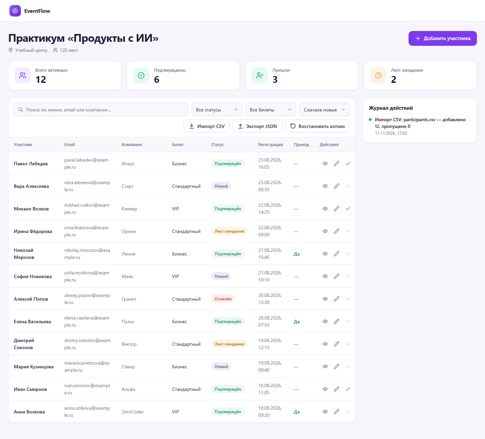
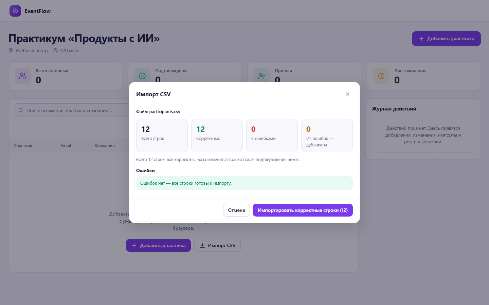
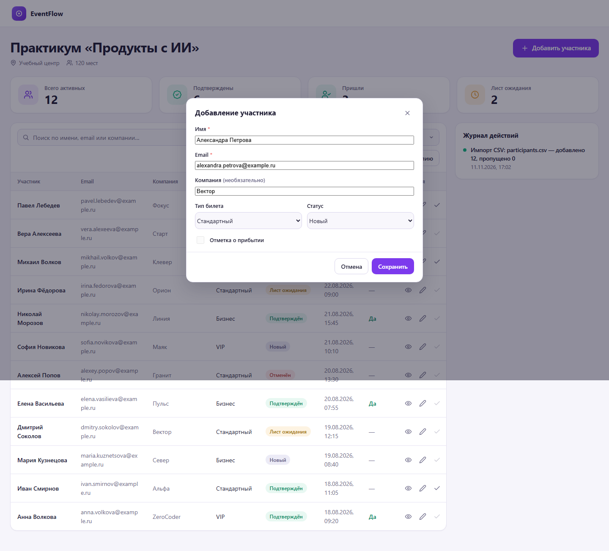
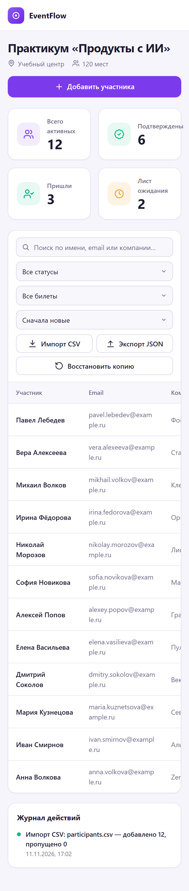

# EventFlow

**Локальный дашборд для управления участниками события.** Регистрации, статусы, check-in, импорт CSV и резервные копии — в одном браузере, без сервера, сборки и внешних зависимостей.

[](https://maximguriev1.github.io/eventflow/)




## Содержание

- [О проекте](#о-проекте)
- [Демо](#демо)
- [Возможности](#возможности)
- [Скриншоты](#скриншоты)
- [Технологии](#технологии)
- [Архитектура](#архитектура)
- [Схема IndexedDB](#схема-indexeddb)
- [Формат CSV](#формат-csv)
- [Резервные копии](#резервные-копии)
- [Запуск](#запуск)
- [Проверка](#проверка)
- [Ветки и релизы](#ветки-и-релизы)
- [Деплой](#деплой)
- [Дорожная карта](#дорожная-карта)
- [Лицензия](#лицензия)
- [Автор](#автор)

## О проекте

EventFlow — портфолио-проект: одностраничное приложение для организатора образовательного события. Регистрации приходят из формы, писем и таблиц, а перед мероприятием нужно быстро понять, сколько человек подтвердили участие, кто находится в листе ожидания и кто уже пришёл. EventFlow собирает разрозненные CSV в один управляемый список с показателями, поиском, журналом действий и резервными копиями.

Ключевое ограничение — полностью клиентское приложение: только HTML, CSS и современный JavaScript, без npm, сборщиков, CDN и сетевых запросов. Все пользовательские данные хранятся в IndexedDB браузера.

## Демо

**https://maximguriev1.github.io/eventflow/**

Демо полностью рабочее: можно добавлять участников, импортировать `data/participants.csv`, экспортировать и восстанавливать копии. Данные хранятся только в вашем браузере и никуда не отправляются.

## Возможности

### Дашборд

- Четыре показателя: всего активных, подтверждены, пришли, лист ожидания. Пересчитываются после каждого изменения.
- Заголовок события, площадка и вместимость из справочника.
- Журнал последних действий: добавления, изменения, импорты, архивация, экспорт и восстановление.

### Участники

- Создание, просмотр и редактирование в одной диалоговой форме.
- Валидация: обязательные имя и email, формат email, допустимые статусы и типы билетов.
- Уникальность email без учёта регистра.
- Check-in только для подтверждённого участника.
- Архивация вместо удаления и кнопка «Отменить» в уведомлении.
- Поиск по имени, email и компании, фильтры по статусу и билету, сортировка по имени и дате регистрации.

### Импорт CSV

- Предпросмотр до изменения базы: всего строк, корректные, с ошибками, дубликаты.
- Номер строки и понятная причина для каждой ошибки.
- Импорт только корректных строк одной транзакцией.
- Ошибочные строки не попадают в IndexedDB.

### Резервные копии

- Экспорт JSON с полями `schemaVersion`, `exportedAt`, `event`, `participants`, `activity`.
- Восстановление с проверкой структуры и версии, предпросмотром и отдельным подтверждением.
- Опция скачать текущую копию перед заменой.
- Полная замена данных одной транзакцией: при сбое база остаётся прежней.

### Интерфейс

- Светлая SaaS-тема: фиолетовый акцент, мятные успешные состояния, янтарные предупреждения, коралловые ошибки.
- Адаптивность на 1440, 768 и 390 px.
- Loading-скелетоны, пустые состояния, фатальная ошибка и toast-уведомления.
- Доступность: управление с клавиатуры, видимый фокус, `aria-live`, `prefers-reduced-motion`.

## Скриншоты

| Главный экран | Предпросмотр импорта CSV |
| --- | --- |
|  |  |
| **Форма участника** | **Мобильная версия, 390 px** |
|  |  |

## Технологии

| Слой | Решение |
| --- | --- |
| Разметка | HTML5, семантические элементы, `<dialog>` |
| Стили | CSS3: custom properties, Grid, Flexbox, media queries |
| Логика | Vanilla JavaScript (ES2020+), IIFE-модули |
| Хранение | IndexedDB, база `eventflow-db`, версия 1 |
| Файлы | File API, Blob, `URL.createObjectURL` |
| Сборка | Нет |
| Зависимости | Нет |

Почему без фреймворков: это ограничение задачи и одновременно упражнение на фундаментальные вещи — работу с DOM, транзакции IndexedDB, парсинг CSV и доступность интерфейса.

## Архитектура

```text
eventflow/
├── .nojekyll                   # отключает Jekyll на GitHub Pages
├── index.html                  # семантическая разметка и диалоги
├── assets/
│   ├── css/
│   │   └── styles.css          # токены, компоненты, состояния, адаптивность
│   └── js/
│       ├── db.js               # IndexedDB: схема, миграции, транзакции
│       ├── csv.js              # парсер и валидатор CSV
│       └── app.js              # состояние UI, рендеринг, сценарии
├── data/
│   ├── event-settings.json     # справочник события
│   ├── participants.csv        # 12 корректных строк
│   └── participants-with-errors.csv
└── docs/
    └── screenshots/
```

| Файл | Ответственность |
| --- | --- |
| `assets/js/db.js` | Открытие базы, идемпотентная схема, CRUD, пакетный импорт, экспорт и восстановление — всё через транзакции |
| `assets/js/csv.js` | Чистые функции разбора и проверки CSV; не обращается к IndexedDB |
| `assets/js/app.js` | Состояние интерфейса, рендеринг, формы, фильтры, уведомления, сценарии импорта и восстановления |
| `assets/css/styles.css` | Дизайн-токены, компоненты, состояния, адаптивность, `prefers-reduced-motion` |

Поток данных:

1. `app.js` инициализирует `db.js` и загружает справочник события и записи.
2. Действие пользователя проходит валидацию и попадает в одну транзакцию `db.js` вместе с записью в журнал.
3. После транзакции данные читаются заново: KPI → таблица → журнал.
4. `csv.js` разбирает файл и возвращает отчёт об ошибках до записи в базу.

Принятые решения:

- **Одна форма** для просмотра, создания и редактирования — меньше дублирования и одинаковые правила валидации.
- **Архивация вместо удаления** — запись остаётся в базе, но не попадает в KPI и обычную выдачу; действие можно отменить.
- **Транзакционность** — импорт, восстановление и запись в журнал выполняются в одной транзакции, поэтому частичных изменений не бывает.
- **Уникальность email на уровне схемы** — индекс по нормализованному `emailLower` с `unique: true`.

## Схема IndexedDB

База `eventflow-db`, версия 1.

| Хранилище | Ключ | Индексы | Назначение |
| --- | --- | --- | --- |
| `participants` | `id` (UUID) | `email` (уникальный, по `emailLower`), `status`, `registeredAt`, `archivedAt` | Участники |
| `settings` | `key` | — | Справочник события и версия схемы |
| `activity` | `id` (autoincrement) | — | Журнал действий |

Модель участника:

| Поле | Тип | Правило |
| --- | --- | --- |
| `id` | string | UUID, создаётся приложением |
| `name` | string | Обязательное, непустое |
| `email` | string | Обязательный корректный email |
| `emailLower` | string | Нормализованный email для уникального индекса |
| `company` | string | Необязательное |
| `ticket` | string | `standard`, `business`, `vip` |
| `status` | string | `new`, `confirmed`, `waitlist`, `cancelled` |
| `checkedIn` | boolean | `true` только при статусе `confirmed` |
| `registeredAt` | string | ISO-дата |
| `archivedAt` | string \| null | Дата архивации или `null` |

## Формат CSV

Обязательные колонки: `name`, `email`, `ticket`, `status`, `checked_in`, `registered_at`. Колонка `company` необязательна, лишние колонки игнорируются.

```csv
name,email,company,ticket,status,checked_in,registered_at
Анна Волкова,anna.volkova@example.ru,ZeroCoder,vip,confirmed,true,2026-08-18T09:20:00Z
```

Правила:

- `ticket`: `standard`, `business`, `vip`.
- `status`: `new`, `confirmed`, `waitlist`, `cancelled`.
- `checked_in`: `true` или `false`; `true` допустим только для `confirmed`.
- `registered_at`: дата в ISO-формате.
- Дубликаты email проверяются внутри файла и против базы.
- Парсер совместим с RFC 4180: кавычки, `""` внутри кавычек, запятые и переводы строк внутри кавычек, BOM, `\r\n`, `\n`, `\r`.

Тестовые файлы:

- `data/participants.csv` — 12 корректных строк;
- `data/participants-with-errors.csv` — 2 корректные и 6 ошибочных строк, включая дубликаты.

## Резервные копии

```json
{
  "schemaVersion": 1,
  "exportedAt": "2026-11-11T17:03:55.501Z",
  "event": {
    "name": "Практикум «Продукты с ИИ»",
    "venue": "Учебный центр",
    "capacity": 120,
    "statuses": [],
    "tickets": []
  },
  "participants": [],
  "activity": []
}
```

При восстановлении проверяются обязательные поля, версия схемы, типы записей и допустимость статусов и билетов. Неверный или несовместимый файл не меняет базу. Замена выполняется одной транзакцией; перед ней можно скачать текущую копию.

## Запуск

Приложению нужен HTTP-сервер: так IndexedDB и загрузка файлов работают предсказуемо, без ограничений `file://`.

```bash
# Python 3
python -m http.server 8000

# или Node.js
npx serve .
```

Откройте <http://localhost:8000>.

Сборка и установка зависимостей не требуются.

## Проверка

Что проверено вручную в Chromium (Microsoft Edge, headless):

- [x] Импорт `participants.csv`: 12 строк, KPI 12 / 6 / 3 / 2.
- [x] Предпросмотр `participants-with-errors.csv`: 2 корректные строки и 6 ошибок с номерами строк и причинами.
- [x] Данные сохраняются после перезагрузки страницы.
- [x] Экспорт: JSON с `schemaVersion: 1`, 12 участниками и журналом.
- [x] Восстановление: предпросмотр, подтверждение и полная замена данных.
- [x] Форма: пустые обязательные поля блокируют сохранение, ошибки показываются рядом с полем.
- [x] Адаптивность: 1440 и 390 px без горизонтального скролла страницы.
- [x] Нет внешних сетевых запросов: загружаются только локальные CSS, JS и CSV.

## Ветки и релизы

Модель упрощённого Git Flow:

- `main` — стабильная ветка; каждый push автоматически деплоится на GitHub Pages.
- `develop` — интеграционная ветка для следующих изменений.
- `feature/*` — короткоживущие ветки под задачи; вливаются в `develop`.
- Релизы — аннотированные теги на `main` (`v1.0.0`).

Сообщения коммитов — в формате Conventional Commits: `feat:`, `fix:`, `docs:`, `ci:`.

## Деплой

GitHub Pages публикует статический сайт напрямую из ветки `main` (корень репозитория). Отдельная сборка не нужна: приложение уже статическое, а `.nojekyll` отключает обработку Jekyll. Каждый push в `main` обновляет демо.

## Дорожная карта

- [ ] Несколько событий с переключением.
- [ ] Экспорт отфильтрованного списка в CSV.
- [ ] Массовые действия: архивация и смена статуса.
- [ ] Горячие клавиши.
- [ ] PWA-режим и офлайн-установка.
- [ ] Автотесты (Playwright) для критических сценариев.

## Лицензия

MIT — см. [LICENSE](LICENSE).

## Автор

**Maxim Guriev**

- GitHub: [@MaximGuriev1](https://github.com/MaximGuriev1)

---

<details>
<summary>English summary</summary>

EventFlow is a local-first participant management dashboard for events. It is built with vanilla HTML, CSS and JavaScript plus IndexedDB — no build step, no dependencies and no network requests. Features: participant CRUD, validation, search, filters, sorting, check-in, archive with undo, CSV import with preview and row-level errors, JSON backup and restore, activity log, responsive layout and an accessible UI.

Live demo: <https://maximguriev1.github.io/eventflow/>

</details>
